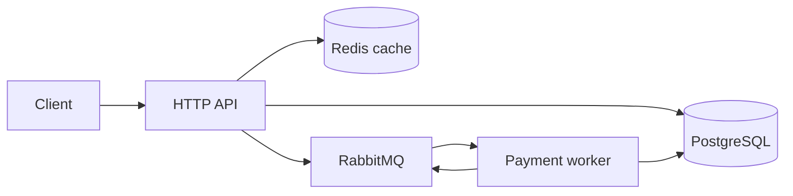
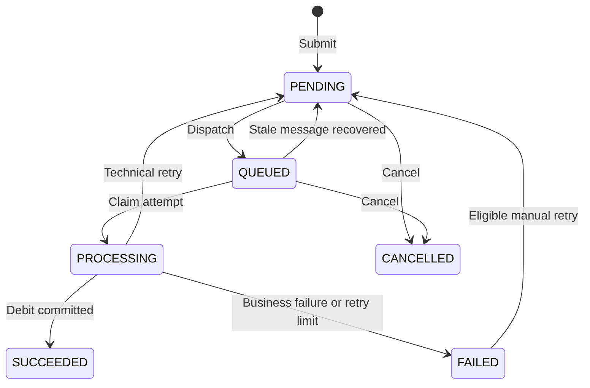

# Asynchronous User Credit Payment Backend

A NestJS service that keeps a per-user credit balance and processes payment requests asynchronously. PostgreSQL is the source of truth for balances, payment status, and the ledger. RabbitMQ only wakes the worker; a delivered message is never trusted to mean "process this exactly once."

## Contents

- [Architecture](#architecture)
- [Payment lifecycle](#payment-lifecycle)
- [HTTP API](#http-api)
- [Run with Docker Compose](#run-with-docker-compose)
- [Run the app on the host](#run-the-app-on-the-host)
- [Testing](#testing)
- [Configuration](#configuration)
- [Troubleshooting](#troubleshooting)

## Technology stack

- Node.js 24 LTS and TypeScript
- NestJS 12
- PostgreSQL 18 and Prisma ORM 7 with the PostgreSQL driver adapter
- RabbitMQ 4, using `amqplib` and `amqp-connection-manager`
- Redis 8 via Nest's cache manager and `@keyv/redis` (cache only; it is not authoritative)
- Docker Compose
- decimal.js for monetary arithmetic
- OpenAPI via Swagger UI at `/docs`

## Architecture

The domain does not import NestJS, Prisma, RabbitMQ, or Redis. Each business module is a hexagon:

- **Domain** holds the aggregates, invariants, and repository contracts.
- **Application** orchestrates use cases and defines the ports they need.
- **Infrastructure** implements those ports with Prisma, RabbitMQ, and Redis.
- **Presentation** adapts HTTP into use case calls.

```text
src/
├── main.ts                          # HTTP API
├── worker.ts                        # consumer, dispatcher, reconciler
├── modules/
│   ├── users/                       # accounts and the append-only ledger
│   ├── payments/                    # payment aggregate and async processing
│   └── admin/                       # read-side reports
└── shared/                          # money, unit of work, clock, cache, errors
```

`users` exposes account use cases. `payments` depends only on its own account ports; an adapter in the payments infrastructure calls those use cases. Both sides share one `UnitOfWork`, so a debit and the payment status commit in the same database transaction.



The API uses Nest CQRS commands and queries to dispatch requests to application
handlers. The worker runs separately and uses the same domain and persistence
layers. PostgreSQL stores payment state and the append-only ledger; Redis can be
unavailable without becoming the authority for a financial operation.

Amounts are integers of minor units. The domain calculates them with decimal.js and stores them as `BIGINT` in PostgreSQL. The API accepts and returns them as strings, never as JSON numbers.

## Payment lifecycle

`POST /payments` commits a `PENDING` payment and returns `202` even when the broker is down. The row is the outbox. A dispatcher publishes it and then marks it `QUEUED` in the same transaction as the row lock. The worker claims a `QUEUED` row (`PROCESSING`, attempt + 1). If the balance is insufficient, it goes directly to settlement; otherwise it runs the failure simulator outside a transaction before settling. Settlement checks the balance again under a lock:

- sufficient balance: one ledger `DEBIT` and `SUCCEEDED`, atomically
- insufficient balance: `FAILED`, not retried until the balance can cover it
- technical or simulated failure: `PENDING` again with `next_dispatch_at`, or `FAILED` when the attempt budget is exhausted

The settlement writes the debit only when the row is still `PROCESSING` for the attempt that was claimed. A worker that lost its lease cannot debit. The reconciler returns expired `PROCESSING` rows and stale `QUEUED` rows to the dispatcher. Retries are recorded in `payment_events`.



`attempts` counts processing claims, including the first attempt. The default
`PAYMENT_MAX_ATTEMPTS=5` permits up to five total attempts for automatic technical
retries. An insufficient balance is a business failure; it is not automatically
retried. A manual retry is allowed once the account balance covers the amount.

The simulator fails more often as the amount grows (`PAYMENT_FAILURE_PER_MINOR_UNIT`, capped by `PAYMENT_MAX_FAILURE_PROBABILITY`). A reference containing `FAIL` (or another token in `PAYMENT_FORCED_FAILURE_REFERENCES`) always fails technically, so the retry path can be observed. Set the probability to `0` and the pattern list to empty to disable simulation.

## HTTP API

| Method | Path                                  | Notes                                                       |
| ------ | ------------------------------------- | ----------------------------------------------------------- |
| `POST` | `/users`                              | Create an account. Optional `initialBalance`.               |
| `GET`  | `/users/:id`                          | Account and balance.                                        |
| `POST` | `/users/:id/credits`                  | Add credit. Requires `Idempotency-Key`.                     |
| `POST` | `/payments`                           | Queue a payment. Requires `Idempotency-Key`. Returns `202`. |
| `GET`  | `/payments/:id`                       | Payment status.                                             |
| `GET`  | `/payments/:id/events`                | Status history.                                             |
| `POST` | `/payments/:id/retry`                 | Manual retry of a failed payment.                           |
| `POST` | `/payments/:id/cancel`                | Cancel a `PENDING` or `QUEUED` payment.                     |
| `GET`  | `/admin/users`                        | Accounts and balances.                                      |
| `GET`  | `/admin/users/:id`                    | One account.                                                |
| `GET`  | `/admin/users/:id/transactions`       | That account's ledger.                                      |
| `GET`  | `/admin/reports/transactions/summary` | Credits and debits by `daily`, `monthly`, or `yearly`.      |
| `GET`  | `/admin/reports/balance-usage`        | Credits, debits, and balance per user.                      |

`Idempotency-Key` is a UUID v4. Reusing it for the same request returns the original result. Payment replays compare the request fields; credit replays compare the amount. Reusing a key with conflicting details returns `409`. Admin routes require `X-Admin-Api-Key`. Unknown failures return `500` with a request id and no stack trace; send `X-Request-Id` to supply one.

Use a new idempotency key for each new credit or payment. Reuse the original key
only when retrying the same request. The Swagger example key is fixed, so replace
it when making a different request.

| HTTP status   | Meaning                                                                         |
| ------------- | ------------------------------------------------------------------------------- |
| `200` / `201` | Read or synchronous operation completed.                                        |
| `202`         | Payment accepted for asynchronous processing; check its status later.           |
| `400`         | Invalid input, identifier, or idempotency key.                                  |
| `401`         | Missing or incorrect admin API key.                                             |
| `404`         | User or payment was not found.                                                  |
| `409`         | A conflicting idempotency key or an operation not allowed in the current state. |
| `422`         | A business rule could not be satisfied.                                         |
| `500`         | An unexpected server error; use the response request ID to find its log.        |

Interactive documentation is served at [http://127.0.0.1:3000/docs](http://127.0.0.1:3000/docs). The raw document is at `/docs-json`.

```sh
curl -s -X POST http://127.0.0.1:3000/users \
  -H 'content-type: application/json' \
  -d '{"email":"ada@example.com","name":"Ada","initialBalance":"5000"}'

curl -s -X POST http://127.0.0.1:3000/payments \
  -H 'content-type: application/json' \
  -H 'idempotency-key: 7c9e6679-7425-40de-944b-e07fc1f90ae7' \
  -d '{"userId":"<id>","amount":"1200","reference":"INV-1001","description":"Invoice 1001"}'
```

To add funds and inspect a payment, replace the placeholders and generate a new
UUID v4 for the credit:

```sh
curl -s -X POST 'http://127.0.0.1:3000/users/<user-id>/credits' \
  -H 'content-type: application/json' \
  -H 'idempotency-key: <new-uuid-v4>' \
  -d '{"amount":"500","reference":"top-up","description":"Account credit"}'

curl -s 'http://127.0.0.1:3000/payments/<payment-id>'
curl -s 'http://127.0.0.1:3000/payments/<payment-id>/events'
```

Replace the angle-bracket placeholders before running these commands. A payment's
event history explains whether it was queued, processed, retried, or failed.

`from` is inclusive and `to` is exclusive on the summary report:

```sh
curl -s -H "x-admin-api-key: $ADMIN_API_KEY" \
  "http://127.0.0.1:3000/admin/reports/transactions/summary?period=daily&from=2026-01-01T00:00:00.000Z&to=2026-02-01T00:00:00.000Z"
```

## Prerequisites

- Node.js 24.15 or later on the 24.x LTS line
- npm 10 or later
- Docker Engine and Docker Compose v2

Copy `.env.example` to `.env` and replace the placeholder credentials. `.env` is ignored by Git. The example uses Compose service names. Point those hosts at `localhost` when the Nest process runs on the host.

```sh
cp .env.example .env
npm ci
```

## Run with Docker Compose

```sh
docker compose up --build
```

Compose migrates PostgreSQL before starting the API and the worker, and it waits for PostgreSQL, RabbitMQ, and Redis health checks. Ports bind to loopback. The RabbitMQ management UI is at `http://localhost:15672`.

```sh
docker compose up -d --build
docker compose logs -f app worker
docker compose ps
docker compose down
```

`docker compose down` keeps the `postgres-data` and `redis-data` volumes.

## Run the app on the host

Start the infrastructure, point `.env` at `localhost`, apply migrations, then run the API and the worker in two terminals:

```sh
docker compose up -d postgres rabbitmq redis
npm run prisma:migrate:deploy
npm run start:dev
npm run start:worker:dev
```

The API can accept payments without the worker. Depending on broker availability,
they remain `PENDING` or `QUEUED` until the worker processes them.

## Prisma

Prisma 7 reads the database URL from `prisma.config.ts`. The client is generated into the Prisma infrastructure folder. `npm run build` generates it before compiling.

```sh
npm run prisma:generate
npm run prisma:validate
npm run prisma:migrate:dev -- --name schema_change
npm run prisma:migrate:deploy
npm run prisma:migrate:status
npm run prisma:studio
```

Migrations are not applied on application startup. Compose runs `prisma migrate deploy` as its own one-shot service.

## Available npm scripts

| Script                                     | Purpose                                     |
| ------------------------------------------ | ------------------------------------------- |
| `npm run start:dev`                        | API with watch mode                         |
| `npm run start:worker:dev`                 | Worker with watch mode                      |
| `npm run build`                            | Generate Prisma Client and compile          |
| `npm run start:prod` / `start:worker:prod` | Run the compiled API or worker              |
| `npm run typecheck`                        | Type-check without emitting                 |
| `npm run lint`                             | ESLint                                      |
| `npm run format` / `format:check`          | Prettier                                    |
| `npm test` / `test:watch` / `test:cov`     | Vitest                                      |
| `npm run test:e2e`                         | End-to-end Vitest configuration             |
| `npm run prisma:*`                         | Generate, validate, migrate, or open Studio |

## Testing

### Unit tests and coverage

Run `npm test` for the unit suite or `npm run test:cov` for coverage. The terminal
report lists uncovered lines by file. Open `coverage/index.html` for a detailed
report; `coverage/lcov.info` and `coverage/coverage-summary.json` are available for
CI and other tools.

Coverage includes source files whose names match a unit test in the same area. For
example, `payment.spec.ts` matches `payment.ts` or `payment.handler.ts`. A grouped
test with a different name does not select a source file for the report. The reported
percentage therefore describes the selected files, **not the whole project**. Test
files, generated Prisma code, and E2E execution are excluded.

### End-to-end tests

The E2E suite sends real HTTP requests and checks PostgreSQL. It creates users,
credits, and payments; use a **disposable test stack** with a running API, worker,
PostgreSQL, RabbitMQ, and Redis. The API and worker must point to the same test
database and broker.

1. Copy `.env.test.example` to `.env.test` and fill in the test-only values.
2. Set `DATABASE_URL` to the disposable database as seen by the test process. Use
   `localhost` and the published port when running tests on the host.
3. Set `SYSTEM_TEST_ADMIN_KEY` to the key configured on the test API and
   `SYSTEM_TEST_MAX_ATTEMPTS` to the worker's `PAYMENT_MAX_ATTEMPTS`.
4. Configure the test worker with `PAYMENT_MAX_ATTEMPTS=5`, short retry delays,
   `PAYMENT_FAILURE_PER_MINOR_UNIT=0`, and `PAYMENT_FORCED_FAILURE_REFERENCES=FAIL`.
5. Start the test API and worker, then run `npm run test:e2e`.

The configuration loads `.env.test` first and then fills missing values from `.env`;
variables already set in the shell take precedence. Settings in `.env.test` are read
by the tests and do not change the environment of an already-running worker. If a
payment stays `QUEUED`, check that the worker is running and connected to the same
database and RabbitMQ as the API.

## Configuration

Environment variables are validated at startup. `RABBITMQ_URL` and `REDIS_URL`, when non-empty, override the component settings. `ADMIN_API_KEY` defaults to `change_me` for local development and must be replaced before the API is exposed.

Redis is an optional cache, not the source of truth for payment decisions. Set
`REDIS_CONNECTION_TIMEOUT_MS` to bound the connection handshake (default 1000 ms).
The Redis client disables its offline command queue and reconnects with backoff.
Cache TTLs include up to 10% downward jitter, and concurrent report cache misses
are coalesced within each process. Report values can remain stale for their TTL;
coalescing does not coordinate between replicas.

Payment retries use exponential backoff with jitter (`PAYMENT_MAX_ATTEMPTS`, `PAYMENT_RETRY_BASE_DELAY_MS`, `PAYMENT_RETRY_MAX_DELAY_MS`, `PAYMENT_RETRY_JITTER_RATIO`). The schedule is stored on the payment row. `PAYMENT_PROCESSING_LEASE_MS` is how long a claimed attempt may run before the reconciler takes it back.

| Setting                             | Default | Purpose                                                             |
| ----------------------------------- | ------- | ------------------------------------------------------------------- |
| `APP_PORT`                          | `3000`  | HTTP port inside the API process.                                   |
| `PAYMENT_MAX_ATTEMPTS`              | `5`     | Total automatic processing attempts.                                |
| `PAYMENT_RETRY_BASE_DELAY_MS`       | `1000`  | Initial retry delay in milliseconds.                                |
| `PAYMENT_RETRY_MAX_DELAY_MS`        | `60000` | Maximum exponential delay before jitter.                            |
| `PAYMENT_PROCESSING_LEASE_MS`       | `30000` | Time before a processing attempt can be recovered.                  |
| `PAYMENT_QUEUED_STALE_MS`           | `30000` | Time before an unconsumed queued payment can be recovered.          |
| `PAYMENT_FAILURE_PER_MINOR_UNIT`    | `0`     | Amount-based simulated failure rate; zero disables random failures. |
| `PAYMENT_MAX_FAILURE_PROBABILITY`   | `0.8`   | Cap on the simulated failure probability.                           |
| `PAYMENT_FORCED_FAILURE_REFERENCES` | `FAIL`  | Comma-separated reference tokens that force a simulated failure.    |

See `.env.example` for connection settings and `.env.test.example` for E2E test
settings. Configure the running API and worker themselves; changing a test runner's
environment does not change an already-running service.

Redis caches idempotency lookups and admin aggregates for a short TTL. A Redis outage is logged and ignored; PostgreSQL still decides.

## Troubleshooting

| Symptom                               | What to check                                                                                        |
| ------------------------------------- | ---------------------------------------------------------------------------------------------------- |
| Payment stays `PENDING`               | Check RabbitMQ connectivity and the worker dispatcher logs.                                          |
| Payment stays `QUEUED`                | Check that the worker is running and consuming from the same broker as the API.                      |
| E2E test reports `ENOTFOUND postgres` | Use the test database's host-reachable address in `.env.test`; `postgres` is a Compose network name. |
| Admin request returns `401`           | Match `X-Admin-Api-Key` to the API's `ADMIN_API_KEY`.                                                |
| E2E retry count differs from expected | Match `SYSTEM_TEST_MAX_ATTEMPTS` to the running worker's `PAYMENT_MAX_ATTEMPTS`.                     |
| Credit or payment returns `409`       | Check whether the idempotency key was already used for a different request.                          |

For Compose deployments, `docker compose ps` shows service status and
`docker compose logs -f app worker` shows API and worker logs. A payment's event
endpoint provides its recorded state transitions.
